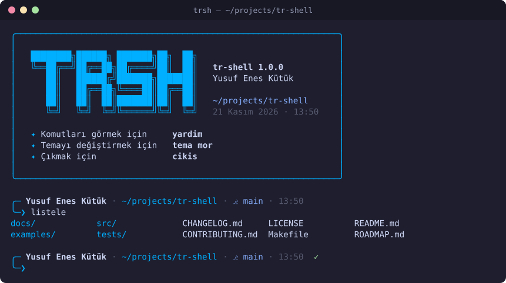
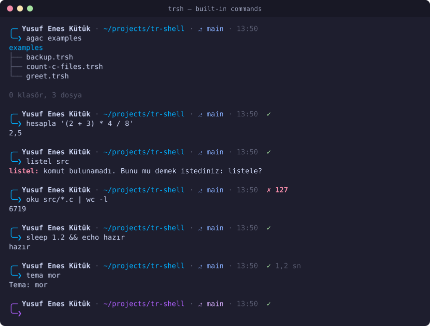
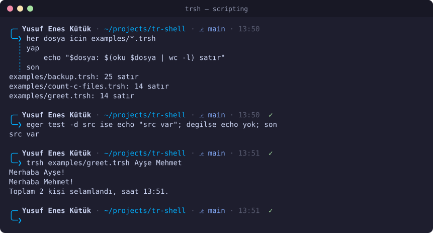

<h1 align="center">tr-shell</h1>

<p align="center">
  <b>A Unix shell written in C, with Turkish commands, a scripting language and a modern prompt.</b>
</p>

<p align="center">
  <a href="https://github.com/yusuffeness/tr-shell/actions/workflows/ci.yml"></a>
  <a href="https://github.com/yusuffeness/tr-shell/releases/latest"></a>
  
  
  <a href="LICENSE"></a>
</p>

<p align="center">
  
</p>

tr-shell (`trsh`) is a complete interactive shell: pipelines, redirection, variables,
job control, line editing and a small scripting language — with every command,
keyword and message in Turkish. Programs in your `PATH` keep working, so `git`, `gcc`
and `ls` sit right next to `listele`, `gec` and `hesapla`.

It began as an Operating Systems course assignment and grew into a hands-on study of
the classic Unix process APIs: `fork`, `execvp`, `waitpid`, `pipe`, `dup2`, signals,
process groups and `tcsetpgrp`. The lexer, parser,
expander, executor and job control are all written from scratch.

## Contents

- [Highlights](#highlights)
- [Getting started](#getting-started)
- [Usage](#usage)
- [Commands](#commands)
- [Shell syntax](#shell-syntax)
- [Scripting](#scripting)
- [Configuration](#configuration)
- [Keyboard](#keyboard)
- [How it works](#how-it-works)
- [Testing](#testing)
- [Contributing](#contributing)
- [License](#license)

## Highlights

- **A real shell language** — quotes and escapes, pipelines of any length,
  `< > >> 2> 2>> 2>&1`, `&&` / `||` / `;`, variables, `$(...)`, file name patterns
  and comments.
- **Scripting in Turkish** — `eger` / `degilse`, `dongu`, `her`, `kir`, `devam`,
  script arguments, `kaynak` and a startup file.
- **Job control** — `&`, Ctrl+Z, `isler`, `on` and `arka`; every job in its own
  process group with its own terminal settings.
- **A prompt that tells you things** — directory, git branch, time, ✓ or ✗ with the
  exit code, and how long slow commands took. Five color themes.
- **Commands written in C** — `listele`, `agac`, `sistem`, a calculator, notes, and a
  `sil` that moves files to a trash you can restore from.
- **Comfortable to use** — readline editing, persistent history with `!!` and `!N`,
  Tab completion, "did you mean …?" for typos, and a Ctrl+C that never kills the shell.
- **Its own screen** — opens on the terminal's alternate screen like `vim`, and your
  previous output comes back when you leave.
- **Configurable** — aliases, theme, prompt name and welcome screen in
  `~/.trsh/config`, editable with `ayar`.
- **Well tested** — a behaviour test suite for every feature, run in CI with gcc and clang and under
  AddressSanitizer and UBSan.

## Getting started

### Requirements

- Linux or WSL (Windows Subsystem for Linux)
- A C11 compiler (`gcc` or `clang`) and `make`
- GNU readline — optional but recommended; it enables line editing, history on the
  arrow keys and Tab completion. The Makefile detects it automatically.

```bash
sudo apt install build-essential libreadline-dev   # Debian, Ubuntu, WSL
```

### Build and run

```bash
git clone https://github.com/yusuffeness/tr-shell.git
cd tr-shell
make          # builds ./trsh
./trsh        # starts the shell; leave with cikis or Ctrl+D
```

### Install

```bash
make install                 # installs trsh and its man page under ~/.local
make install PREFIX=/usr/local
make uninstall
```

Make sure `~/.local/bin` is in your `PATH`, then run `trsh` from anywhere and read the
manual with `man trsh`. Prebuilt Linux binaries are attached to each
[release](https://github.com/yusuffeness/tr-shell/releases).

| Target | |
| --- | --- |
| `make` | Build `./trsh` (objects in `build/`) |
| `make run` | Build and start the shell |
| `make test` | Run the test suite |
| `make debug` | Build with AddressSanitizer and UBSan |
| `make READLINE=0` | Build without readline |
| `make clean` | Remove build output |

For the welcome box and prompt to line up, use a terminal font with box-drawing
characters — Windows Terminal with Cascadia Code, iTerm2, GNOME Terminal and most
modern terminals work out of the box.

## Usage

```text
trsh                              interactive shell
trsh FILE [ARG...]                run a script; $0 is FILE, $1... the arguments
trsh -c 'COMMAND' [NAME ARG...]   run one command string
trsh --surum                      print the version
trsh --yardim                     print usage
```

When standard input is not a terminal — a pipe or a redirected file — commands are
read without a prompt or colors. `NO_COLOR` turns colors off everywhere.

Inside the shell, `yardim` lists every command and `yardim KOMUT` explains one.

<p align="center">
  
</p>

## Commands

| Group | Command | What it does | Runs |
| --- | --- | --- | --- |
| Files | `listele [-a] [-d] [PATH...]` | List files: folders first, colors, `-a` hidden, `-d` details | builtin |
| | `agac [-a] [PATH] [DEPTH]` | Directory tree (depth 3 by default) | builtin |
| | `oku FILE...` | Show file contents | `cat` |
| | `kopyala SRC DST` | Copy files or folders | `cp -r` |
| | `tasi SRC DST` | Move or rename | `mv` |
| | `klasor NAME...` | Create folders, with parents | `mkdir -p` |
| | `olustur FILE...` | Create empty files | `touch` |
| | `bul "PATTERN"` | Find files by name below the current directory | `find . -name` |
| | `ara WORD [PATH]` | Search text inside files | `grep -rn` |
| | `boyut [PATH]` | Show size | `du -sh` |
| | `sil [-e] PATH...` | Ask, then move to the trash (`-e`: don't ask) | builtin |
| | `copkutusu` | List the trash; `geri NO\|NAME` restores, `bosalt` empties | builtin |
| Directories | `gec [DIR]` | Change directory; home if no argument | builtin |
| | `geri` | Go back to the previous directory | builtin |
| | `ev` | Go to the home directory | builtin |
| | `nerdeyim` | Print the current directory | builtin |
| System | `sistem` | OS, CPU, memory, disk, uptime and load at a glance | builtin |
| | `surecler` | List processes by CPU usage | `ps` |
| | `oldur PID...` | Terminate a process | `kill` |
| | `disk` | Disk usage | `df -h` |
| | `bellek` | Memory usage | `free -h` |
| | `kimim` | Current user | `whoami` |
| | `tarih` | Date and time in Turkish | builtin |
| | `zamanla CMD...` | Run a command and show how long it took | builtin |
| Tools | `hesapla EXPR` | Calculator: `+ - * / % ^`, parentheses, `1,5` or `1.5` | builtin |
| | `not TEXT...` | Save a quick note | builtin |
| | `notlar [sil N]` | List notes or delete one | builtin |
| Shell | `yardim [CMD]` | Help | builtin |
| | `gecmis [N]` | Command history; rerun with `!N`, `!!` or `!PREFIX` | builtin |
| | `takmaad [NAME=COMMAND]` | Define your own command, or list them | builtin |
| | `takmaadsil NAME...` | Remove an alias | builtin |
| | `ayar [KEY VALUE \| duzenle \| sifirla]` | Show or change settings | builtin |
| | `isler` | List background and stopped jobs | builtin |
| | `on [N]` | Bring a job to the foreground (`fg`) | builtin |
| | `arka [N]` | Continue a stopped job in the background (`bg`) | builtin |
| | `degisken [NAME=VALUE... \| sil NAME]` | List, set or remove environment variables | builtin |
| | `tema [NAME]` | List themes or switch: `mavi`, `yesil`, `mor`, `turuncu`, `sade` | builtin |
| | `temizle` | Clear the screen | builtin |
| | `hakkinda` | Version and author | builtin |
| | `kaynak FILE` | Run a script in the current shell (`source`) | builtin |
| | `kir` / `devam` | Leave a loop / go to its next turn (`break` / `continue`) | builtin |
| | `cikis [CODE]` / `exit` | Leave the shell, optionally with an exit code | builtin |
| | `cd DIR` | Classic change directory | builtin |

For commands that run a standard tool, extra arguments are passed through:
`kopyala -v a b` runs `cp -r -v a b`.

## Shell syntax

```bash
echo "iki   boşluk" 'tek $HOME' a\ b      # quotes and escapes
oku notlar.txt | grep sınav | wc -l     # pipelines
listele > liste.txt 2> hatalar.txt     # redirection: < > >> 2> 2>> 2>&1
make && ./trsh || echo derlenemedi     # run the next one on success / failure
klasor yeni; gec yeni                  # one after the other
AD=Enes; echo "Merhaba $AD" ~         # variables: $AD ${AD} $? $$ ~
DEBUG=1 ./program                      # variable for one command only
oku *.c                                # * ? [...] match file names
echo "bugün $(date +%A)"               # command substitution
sleep 100 &                            # background job
# a comment
```

Not supported: here-documents, functions, and word splitting of unquoted variables
(`$(...)` and `$@` are split, as in bash).

## Scripting

Control flow uses Turkish keywords. A block can be written on one line or across
several; in the interactive shell an open block shows a `┆` prompt until its `son`.

```bash
eger test -f notlar.txt ise         # if ... then
    echo "notlar var"
degilse                             # else
    echo "notlar yok"
son                                 # fi

dongu test $i -lt 3 yap echo $i; degisken i=$(expr $i + 1); son   # while

her dosya icin *.c yap              # for ... in ... do
    echo "derleniyor: $dosya"
son
```

| tr-shell | bash | Notes |
| --- | --- | --- |
| `eger KOMUT ise ... [degilse ...] son` | `if; then; else; fi` | `ise` may follow the condition without `;` |
| `dongu KOMUT yap ... son` | `while; do; done` | |
| `her AD icin KELİMELER yap ... son` | `for in; do; done` | words are expanded and globbed |
| `kir`, `devam` | `break`, `continue` | |
| `kaynak DOSYA` | `source` | runs a file in the current shell |
| `cikis [KOD]` | `exit` | |

Keywords count only where a command starts and only when unquoted: `echo son` prints
`son`, and `"ise"` is an ordinary word. Blocks nest, and a whole block can be
redirected (`... son > sonuc.txt`), piped or sent to the background.

**Scripts.** Put commands in a file and run it with `trsh betik.trsh arg1 arg2`, or
add a `#!/usr/bin/env trsh` first line and make it executable. Inside a script `$0`
is its name, `$1` … `$9` the arguments, `$#` their count and `$@` all of them
(`"$@"` keeps each argument whole). `cikis 3` ends it with exit code 3.

**Startup file.** If `~/.trsh/baslangic` exists, the interactive shell runs it before
the first prompt — the place for variables and aliases, like `~/.bashrc`.

<p align="center">
  
</p>

The [`examples/`](examples) folder has complete scripts:

| Script | Shows |
| --- | --- |
| [`greet.trsh`](examples/greet.trsh) | Arguments, `"$@"`, `eger`, `cikis` |
| [`count-c-files.trsh`](examples/count-c-files.trsh) | `her`, `devam`, nested `$(...)` |
| [`backup.trsh`](examples/backup.trsh) | Counters, `degilse`, `&&`, dated folders |

## Configuration

Settings and aliases live in `~/.trsh/config`. You can edit it by hand (`ayar duzenle`
opens it in `$EDITOR`) or change it from the shell:

```bash
ayar isim Yusuf Enes Kütük      # name shown in the prompt (default: your account name)
ayar tema mor                   # mavi, yesil, mor, turuncu, sade
ayar karsilama sade             # welcome screen: acik, sade, kapali
ayar gecmis_boyutu 5000         # history lines to keep
takmaad ll=listele -d           # your own command
takmaad guncelle='git pull && make'
```

```ini
tema = mor
isim = Yusuf Enes Kütük
karsilama = acik
gecmis_boyutu = 1000

[takmaad]
ll = listele -d
guncelle = git pull && make
```

A line the shell cannot understand is reported with its line number and skipped.

## Keyboard

| Key | Action |
| --- | --- |
| Ctrl+C | Discard the line or open block being typed, or stop the running command or loop |
| Ctrl+Z | Stop the running job; resume it with `on` or `arka` |
| Ctrl+D | Leave the shell (on an empty line) |
| ↑ / ↓, Ctrl+R | Browse and search history (with readline) |
| Tab | Complete command and file names (with readline) |

## How it works

```text
 input ──► lexer ──► aliases ──► parser ──► executor ──► fork / execvp
 readline   tokens    takmaad    syntax tree  expansion    jobs, waitpid
```

A line is split into tokens, aliases are expanded, and a recursive-descent parser
builds a syntax tree of lists, pipelines and compound commands. Each command is
expanded just before it runs. A lone builtin or block runs inside the shell so it can
change the shell's state; everything else is forked, connected with pipes and placed
in its own process group. [docs/ARCHITECTURE.md](docs/ARCHITECTURE.md) walks through
the code in detail.

```text
src/        the shell: one module per concern (lexer, parser, expand, executor, jobs ...)
tests/      behaviour tests: cases/*.in → cases/*.out, run by tests/run.sh
examples/   example scripts
docs/       architecture notes, man page, screenshots
```

## Testing

```bash
make test                     # all tests
bash tests/run.sh kaynak      # only tests whose name contains "kaynak"
make debug && bash tests/run.sh   # under AddressSanitizer and UBSan
```

Each `tests/cases/NAME.in` is fed to the shell and its output and exit status are
compared with `NAME.out`. Every push and pull request runs the suite with gcc and
clang, with and without readline, and under the sanitizers.

## Contributing

Bug reports and pull requests are welcome. See [CONTRIBUTING.md](CONTRIBUTING.md) for
the development setup, code style and how to add a command or a test, and
[CHANGELOG.md](CHANGELOG.md) for the release history.

## License

[MIT](LICENSE) © 2026 Yusuf Enes Kütük
